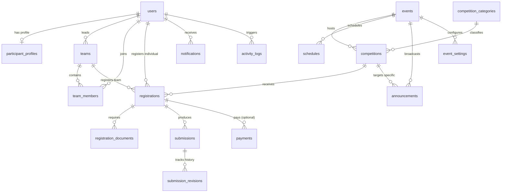

# Database Design Document — IT Competition Management Platform

| Metadata | Value |
|---|---|
| Product | IT Competition Management Platform |
| Document Version | 1.0.0 |
| Baseline | `PRD.md`, `AGENTS.md`, `ARCHITECTURE.md` |
| RDBMS | MySQL 8.0+ (InnoDB Engine) |
| Character Set | `utf8mb4` |
| Collation | `utf8mb4_unicode_ci` |
| Timezone Convention | Timestamps stored in UTC / standard datetime; displayed in `Asia/Jakarta` (WIB) |

---

## 1. Konvensi & Prinsip Desain Database

1. **Foreign Key Integrity**:
   - Seluruh relasi relasional wajib menggunakan deklarasi Foreign Key eksplisit.
   - Entitas transaksional dan audit (registrasi, dokumen, pembayaran, submisi, log audit) menggunakan aksi `ON DELETE RESTRICT` untuk mencegah terhapusnya riwayat kompetisi secara tidak sengaja.
   - Relasi dependen murni (seperti `participant_profiles` terhadap `users`, atau `team_members` terhadap `teams`) dapat menggunakan `ON DELETE CASCADE` bila disetujui.

2. **Tipe Data & Standarisasi Kolom**:
   - Primary Key: `bigint unsigned auto_increment` (internal) dengan kolom bisnis unik (misal: `registration_number`, `team_code`, `slug`) untuk eksposur publik.
   - Nilai Keuangan: `decimal(12, 2)` untuk `registration_fee` dan `amount`. Tidak menggunakan `float` atau `double`.
   - String Pendek / Identifikasi: `varchar(255)` atau ukuran terdefinisi.
   - Text / JSON: Menggunakan tipe `text` untuk deskripsi panjang dan `json` untuk konfigurasi fleksibel (`old_values`, `new_values` pada log audit).
   - Timestamp: Kolom standar Laravel `created_at` dan `updated_at`.

3. **Pencegahan Data Duplikat & Race Conditions**:
   - `team_members`: Kombinasi unik `(team_id, user_id)` menjamin seorang user tidak dapat terdaftar ganda di tim yang sama.
   - `registrations`: Kombinasi unik `(competition_id, participant_id)` untuk kompetisi individual dan `(competition_id, team_id)` untuk kompetisi tim (atau dicek via database constraint / transaction lock) untuk mencegah pendaftaran ganda pada kompetisi yang sama.
   - `event_settings`: Kombinasi unik `(event_id, setting_key)`.

4. **Pengelolaan File & Privasi**:
   - Database hanya menyimpan *relatif path* atau *file storage key*, ekstensi, MIME type, ukuran berkas, dan nama file asli.
   - Tidak pernah menyimpan file dalam bentuk BLOB di database.

---

## 2. Diagram Relasi Entitas (Entity-Relationship Diagram)

---

## 3. Spesifikasi Skema Tabel

### 3.1. `users`
Menyimpan kredensial autentikasi pengguna dan peran akses.

| Kolom | Tipe Data | Nullable | Keterangan |
|---|---|---|---|
| `id` | BIGINT UNSIGNED | No | Primary Key, Auto Increment |
| `name` | VARCHAR(255) | No | Nama lengkap pengguna |
| `email` | VARCHAR(255) | No | Unique, email aktif pengguna |
| `password` | VARCHAR(255) | No | Password ter-hash (Bcrypt/Argon2) |
| `role` | ENUM('participant', 'admin') | No | Default: `'participant'` |
| `is_active` | BOOLEAN | No | Default: `true` (kontrol deaktivasi akun) |
| `email_verified_at`| TIMESTAMP | Yes | Default: `null` |
| `remember_token` | VARCHAR(100) | Yes | Token untuk remember me |
| `created_at` | TIMESTAMP | Yes | Standar Laravel |
| `updated_at` | TIMESTAMP | Yes | Standar Laravel |

**Indeks:**
- `UNIQUE (email)`
- `INDEX (role, is_active)`

---

### 3.2. `participant_profiles`
Menyimpan profil detail peserta (relasi 1:1 dengan `users`).

| Kolom | Tipe Data | Nullable | Keterangan |
|---|---|---|---|
| `id` | BIGINT UNSIGNED | No | Primary Key, Auto Increment |
| `user_id` | BIGINT UNSIGNED | No | Unique, FK ke `users.id` (ON DELETE CASCADE) |
| `phone` | VARCHAR(30) | Yes | Nomor telepon/WhatsApp aktif |
| `institution` | VARCHAR(255) | Yes | Asal institusi / sekolah / universitas |
| `education_level` | VARCHAR(50) | Yes | Misal: SMA/SMK, Diploma, S1 |
| `identity_number` | VARCHAR(50) | Yes | Nomor identitas (NISN/NIM/NIK jika disetujui) |
| `address` | TEXT | Yes | Alamat domisili |
| `profile_photo_path`| VARCHAR(255) | Yes | Path foto profil (di storage publik) |
| `created_at` | TIMESTAMP | Yes | Standar Laravel |
| `updated_at` | TIMESTAMP | Yes | Standar Laravel |

**Indeks:**
- `UNIQUE (user_id)`
- `INDEX (institution)`

---

### 3.3. `events`
Menyimpan data perhelatan acara utama yang memayungi rangkaian kompetisi.

| Kolom | Tipe Data | Nullable | Keterangan |
|---|---|---|---|
| `id` | BIGINT UNSIGNED | No | Primary Key, Auto Increment |
| `name` | VARCHAR(255) | No | Nama acara (misal: "IT Festival 2026") |
| `slug` | VARCHAR(255) | No | Unique URL slug |
| `description` | TEXT | Yes | Deskripsi lengkap acara |
| `theme` | VARCHAR(255) | Yes | Tema acara (misal: "Innovate for Future") |
| `start_date` | DATE | No | Tanggal mulai perhelatan |
| `end_date` | DATE | No | Tanggal akhir perhelatan |
| `location` | VARCHAR(255) | Yes | Lokasi acara fisik atau Online |
| `status` | ENUM('draft', 'published', 'ongoing', 'completed', 'archived') | No | Default: `'draft'` |
| `created_at` | TIMESTAMP | Yes | Standar Laravel |
| `updated_at` | TIMESTAMP | Yes | Standar Laravel |

**Indeks:**
- `UNIQUE (slug)`
- `INDEX (status)`

---

### 3.4. `competition_categories`
Kategori pengelompokan kompetisi IT (misal: Web Development, UI/UX, Competitive Programming).

| Kolom | Tipe Data | Nullable | Keterangan |
|---|---|---|---|
| `id` | BIGINT UNSIGNED | No | Primary Key, Auto Increment |
| `name` | VARCHAR(100) | No | Nama kategori |
| `slug` | VARCHAR(100) | No | Unique URL slug |
| `description` | TEXT | Yes | Keterangan kategori |
| `created_at` | TIMESTAMP | Yes | Standar Laravel |
| `updated_at` | TIMESTAMP | Yes | Standar Laravel |

**Indeks:**
- `UNIQUE (slug)`

---

### 3.5. `competitions`
Data cabang kompetisi yang dapat diikuti oleh peserta.

| Kolom | Tipe Data | Nullable | Keterangan |
|---|---|---|---|
| `id` | BIGINT UNSIGNED | No | Primary Key, Auto Increment |
| `event_id` | BIGINT UNSIGNED | No | FK ke `events.id` (ON DELETE RESTRICT) |
| `category_id` | BIGINT UNSIGNED | No | FK ke `competition_categories.id` (ON DELETE RESTRICT) |
| `name` | VARCHAR(255) | No | Nama cabang kompetisi |
| `slug` | VARCHAR(255) | No | Unique URL slug |
| `short_description` | VARCHAR(500) | Yes | Ringkasan untuk kartu katalog |
| `description` | LONGTEXT | No | Detail lengkap, peraturan, dan kriteria |
| `cover_image_path` | VARCHAR(255) | Yes | Path banner/cover kompetisi |
| `eligibility` | TEXT | Yes | Kriteria peserta (jenjang, usia, syarat) |
| `registration_type` | ENUM('individual', 'team') | No | Mode pendaftaran |
| `min_members` | TINYINT UNSIGNED | No | Default: 1 (validasi bila mode team) |
| `max_members` | TINYINT UNSIGNED | No | Default: 1 (validasi bila mode team) |
| `registration_fee` | DECIMAL(12, 2) | No | Default: `0.00` |
| `registration_start`| DATETIME | No | Waktu buka pendaftaran |
| `registration_deadline`| DATETIME | No | Waktu batas akhir pendaftaran |
| `submission_deadline`| DATETIME | Yes | Batas akhir pengumpulan karya lomba |
| `status` | ENUM('draft', 'published', 'registration_open', 'registration_closed', 'ongoing', 'completed', 'archived') | No | Default: `'draft'` |
| `guidebook_path` | VARCHAR(255) | Yes | Path file PDF guidebook / silabus lomba |
| `contact_information`| JSON | Yes | Kontak PIC lomba (WhatsApp, email) |
| `created_at` | TIMESTAMP | Yes | Standar Laravel |
| `updated_at` | TIMESTAMP | Yes | Standar Laravel |
| `deleted_at` | TIMESTAMP | Yes | Soft delete (opsional jika disetujui) |

**Indeks:**
- `UNIQUE (slug)`
- `INDEX (event_id, category_id, status)`
- `INDEX (registration_start, registration_deadline)`

---

### 3.6. `teams`
Menyimpan entitas tim peserta kompetisi.

| Kolom | Tipe Data | Nullable | Keterangan |
|---|---|---|---|
| `id` | BIGINT UNSIGNED | No | Primary Key, Auto Increment |
| `name` | VARCHAR(100) | No | Nama tim |
| `team_code` | VARCHAR(32) | No | Unique kode referensi tim |
| `leader_id` | BIGINT UNSIGNED | No | FK ke `users.id` (Ketua tim) |
| `created_at` | TIMESTAMP | Yes | Standar Laravel |
| `updated_at` | TIMESTAMP | Yes | Standar Laravel |

**Indeks:**
- `UNIQUE (team_code)`
- `INDEX (leader_id)`

---

### 3.7. `team_members`
Daftar anggota tim (relasi N:N antara `teams` dan `users`).

| Kolom | Tipe Data | Nullable | Keterangan |
|---|---|---|---|
| `id` | BIGINT UNSIGNED | No | Primary Key, Auto Increment |
| `team_id` | BIGINT UNSIGNED | No | FK ke `teams.id` (ON DELETE CASCADE) |
| `user_id` | BIGINT UNSIGNED | No | FK ke `users.id` (ON DELETE RESTRICT) |
| `member_role` | ENUM('leader', 'member') | No | Default: `'member'` |
| `joined_at` | DATETIME | No | Waktu bergabung ke tim |
| `created_at` | TIMESTAMP | Yes | Standar Laravel |
| `updated_at` | TIMESTAMP | Yes | Standar Laravel |

**Indeks:**
- `UNIQUE (team_id, user_id)`
- `INDEX (user_id)`

---

### 3.8. `registrations`
Entitas pendaftaran peserta/tim pada suatu cabang kompetisi.

| Kolom | Tipe Data | Nullable | Keterangan |
|---|---|---|---|
| `id` | BIGINT UNSIGNED | No | Primary Key, Auto Increment |
| `registration_number`| VARCHAR(64) | No | Unique, format: `ITC-YYYY-XXXXX` |
| `competition_id` | BIGINT UNSIGNED | No | FK ke `competitions.id` (ON DELETE RESTRICT) |
| `participant_id` | BIGINT UNSIGNED | Yes | FK ke `users.id` (bila mode individual) |
| `team_id` | BIGINT UNSIGNED | Yes | FK ke `teams.id` (bila mode team) |
| `status` | ENUM('draft', 'submitted', 'under_review', 'revision_required', 'approved', 'rejected', 'cancelled') | No | Default: `'draft'` |
| `notes` | TEXT | Yes | Catatan pendaftar atau riwayat ringkas |
| `admin_notes` | TEXT | Yes | Catatan revisi/alasan penolakan dari admin |
| `submitted_at` | DATETIME | Yes | Waktu pendaftar men-submit final |
| `verified_at` | DATETIME | Yes | Waktu verifikasi status disetujui/ditolak |
| `verified_by` | BIGINT UNSIGNED | Yes | FK ke `users.id` (Admin yang memverifikasi) |
| `created_at` | TIMESTAMP | Yes | Standar Laravel |
| `updated_at` | TIMESTAMP | Yes | Standar Laravel |

**Indeks:**
- `UNIQUE (registration_number)`
- `INDEX (competition_id, status)`
- `INDEX (participant_id)`
- `INDEX (team_id)`
- `INDEX (submitted_at)`

---

### 3.9. `registration_documents`
Berkas dokumen persyaratan pendaftaran (KTM, Surat Keterangan Siswa/Mahasiswa, Surat Pernyataan).

| Kolom | Tipe Data | Nullable | Keterangan |
|---|---|---|---|
| `id` | BIGINT UNSIGNED | No | Primary Key, Auto Increment |
| `registration_id` | BIGINT UNSIGNED | No | FK ke `registrations.id` (ON DELETE RESTRICT) |
| `document_type` | VARCHAR(50) | No | Misal: `'student_id_card'`, `'statement_letter'` |
| `file_path` | VARCHAR(255) | No | Path file di private storage (`storage/app/private/documents/`) |
| `original_filename`| VARCHAR(255) | No | Nama asli file saat diunggah |
| `mime_type` | VARCHAR(100) | No | MIME type file (misal: `application/pdf`, `image/jpeg`) |
| `file_size` | INT UNSIGNED | No | Ukuran file dalam bytes |
| `verification_status`| ENUM('pending', 'verified', 'rejected') | No | Default: `'pending'` |
| `verification_note` | TEXT | Yes | Catatan jika dokumen buram atau tidak sesuai |
| `verified_by` | BIGINT UNSIGNED | Yes | FK ke `users.id` (Admin pemverifikasi) |
| `verified_at` | DATETIME | Yes | Waktu verifikasi dokumen |
| `created_at` | TIMESTAMP | Yes | Standar Laravel |
| `updated_at` | TIMESTAMP | Yes | Standar Laravel |

**Indeks:**
- `INDEX (registration_id, document_type)`
- `INDEX (verification_status)`

---

### 3.10. `submissions`
Karya atau hasil pengerjaan kompetisi yang dikumpulkan oleh peserta/tim.

| Kolom | Tipe Data | Nullable | Keterangan |
|---|---|---|---|
| `id` | BIGINT UNSIGNED | No | Primary Key, Auto Increment |
| `registration_id` | BIGINT UNSIGNED | No | FK ke `registrations.id` (ON DELETE RESTRICT) |
| `title` | VARCHAR(255) | No | Judul karya lomba / project |
| `description` | TEXT | Yes | Deskripsi karya / ringkasan proposal |
| `file_path` | VARCHAR(255) | Yes | Path berkas (ZIP / PDF) di private storage |
| `external_url` | VARCHAR(500) | Yes | URL demo / video presentasi (YouTube / Google Drive) |
| `repository_url` | VARCHAR(500) | Yes | URL repositori source code (GitHub/GitLab) |
| `status` | ENUM('not_submitted', 'submitted', 'under_review', 'revision_required', 'accepted', 'rejected') | No | Default: `'submitted'` |
| `submitted_at` | DATETIME | No | Waktu pengumpulan submisi |
| `reviewed_by` | BIGINT UNSIGNED | Yes | FK ke `users.id` (Admin peninjau berkas) |
| `review_note` | TEXT | Yes | Catatan administratif peninjauan berkas |
| `created_at` | TIMESTAMP | Yes | Standar Laravel |
| `updated_at` | TIMESTAMP | Yes | Standar Laravel |

**Indeks:**
- `INDEX (registration_id, status)`
- `INDEX (submitted_at)`

---

### 3.11. `submission_revisions`
Riwayat versi berkas submisi ketika peserta diminta melakukan perbaikan.

| Kolom | Tipe Data | Nullable | Keterangan |
|---|---|---|---|
| `id` | BIGINT UNSIGNED | No | Primary Key, Auto Increment |
| `submission_id` | BIGINT UNSIGNED | No | FK ke `submissions.id` (ON DELETE CASCADE) |
| `file_path` | VARCHAR(255) | Yes | Path arsip berkas versi lama/baru |
| `external_url` | VARCHAR(500) | Yes | URL alternatif versi lama/baru |
| `revision_note` | TEXT | Yes | Keterangan perbaikan dari peserta |
| `submitted_at` | DATETIME | No | Waktu revisi diunggah |
| `created_at` | TIMESTAMP | Yes | Standar Laravel |
| `updated_at` | TIMESTAMP | Yes | Standar Laravel |

**Indeks:**
- `INDEX (submission_id, submitted_at)`

---

### 3.12. `payments` (Modul Opsional)
*Catatan: Modul dinonaktifkan secara baku sampai kebijakan pembayaran dikonfirmasi.*

| Kolom | Tipe Data | Nullable | Keterangan |
|---|---|---|---|
| `id` | BIGINT UNSIGNED | No | Primary Key, Auto Increment |
| `registration_id` | BIGINT UNSIGNED | No | FK ke `registrations.id` (ON DELETE RESTRICT) |
| `amount` | DECIMAL(12, 2) | No | Jumlah pembayaran |
| `payment_method` | VARCHAR(50) | Yes | Misal: Transfer Bank Manual |
| `payment_proof_path`| VARCHAR(255) | Yes | Path bukti transfer di private storage |
| `status` | ENUM('pending', 'verified', 'rejected') | No | Default: `'pending'` |
| `rejection_reason` | TEXT | Yes | Alasan jika bukti tidak valid |
| `verified_by` | BIGINT UNSIGNED | Yes | FK ke `users.id` (Admin keuangan) |
| `verified_at` | DATETIME | Yes | Waktu verifikasi pembayaran |
| `created_at` | TIMESTAMP | Yes | Standar Laravel |
| `updated_at` | TIMESTAMP | Yes | Standar Laravel |

**Indeks:**
- `INDEX (registration_id, status)`

---

### 3.13. `schedules`
Jadwal tahapan perhelatan acara (technical meeting, babak penyisihan, final, webinar).

| Kolom | Tipe Data | Nullable | Keterangan |
|---|---|---|---|
| `id` | BIGINT UNSIGNED | No | Primary Key, Auto Increment |
| `event_id` | BIGINT UNSIGNED | No | FK ke `events.id` (ON DELETE RESTRICT) |
| `title` | VARCHAR(255) | No | Nama agenda / sesi |
| `description` | TEXT | Yes | Uraian agenda kegiatan |
| `start_at` | DATETIME | No | Waktu mulai agenda |
| `end_at` | DATETIME | Yes | Waktu berakhir agenda |
| `location` | VARCHAR(255) | Yes | Lokasi (Aula, Lab, atau Online) |
| `meeting_url` | VARCHAR(500) | Yes | Link Zoom / Google Meet jika online |
| `is_published` | BOOLEAN | No | Default: `true` |
| `created_at` | TIMESTAMP | Yes | Standar Laravel |
| `updated_at` | TIMESTAMP | Yes | Standar Laravel |

**Indeks:**
- `INDEX (event_id, start_at, is_published)`

---

### 3.14. `announcements`
Pengumuman dan berita resmi dari panitia penyelenggara.

| Kolom | Tipe Data | Nullable | Keterangan |
|---|---|---|---|
| `id` | BIGINT UNSIGNED | No | Primary Key, Auto Increment |
| `event_id` | BIGINT UNSIGNED | No | FK ke `events.id` (ON DELETE RESTRICT) |
| `competition_id` | BIGINT UNSIGNED | Yes | FK ke `competitions.id` (ON DELETE SET NULL) |
| `title` | VARCHAR(255) | No | Judul pengumuman |
| `slug` | VARCHAR(255) | No | Unique slug |
| `content` | LONGTEXT | No | Konten isi pengumuman (Markdown / Rich Text) |
| `thumbnail_path` | VARCHAR(255) | Yes | Gambar thumbnail di storage publik |
| `audience` | ENUM('public', 'all_participants', 'specific_competition') | No | Target penerima pengumuman |
| `published_at` | DATETIME | Yes | Waktu rilis pengumuman |
| `status` | ENUM('draft', 'published', 'archived') | No | Default: `'draft'` |
| `created_at` | TIMESTAMP | Yes | Standar Laravel |
| `updated_at` | TIMESTAMP | Yes | Standar Laravel |

**Indeks:**
- `UNIQUE (slug)`
- `INDEX (event_id, audience, status, published_at)`

---

### 3.15. `faqs`
Daftar pertanyaan umum yang sering diajukan untuk halaman FAQ.

| Kolom | Tipe Data | Nullable | Keterangan |
|---|---|---|---|
| `id` | BIGINT UNSIGNED | No | Primary Key, Auto Increment |
| `question` | VARCHAR(500) | No | Pertanyaan |
| `answer` | TEXT | No | Jawaban |
| `category` | VARCHAR(100) | Yes | Misal: Pendaftaran, Teknis Lomba, Biaya |
| `sort_order` | INT | No | Default: 0 (urutan tampilan) |
| `is_published` | BOOLEAN | No | Default: `true` |
| `created_at` | TIMESTAMP | Yes | Standar Laravel |
| `updated_at` | TIMESTAMP | Yes | Standar Laravel |

**Indeks:**
- `INDEX (sort_order, is_published)`

---

### 3.16. `notifications`
Pemberitahuan in-app bagi peserta terkait status registrasi dan revisi.

| Kolom | Tipe Data | Nullable | Keterangan |
|---|---|---|---|
| `id` | BIGINT UNSIGNED | No | Primary Key, Auto Increment |
| `user_id` | BIGINT UNSIGNED | No | FK ke `users.id` (ON DELETE CASCADE) |
| `title` | VARCHAR(255) | No | Judul notifikasi |
| `message` | TEXT | No | Pesan notifikasi |
| `type` | VARCHAR(50) | No | Misal: `registration_approved`, `revision_needed` |
| `action_url` | VARCHAR(255) | Yes | Deep link ke halaman terkait di portal |
| `read_at` | TIMESTAMP | Yes | Default: `null` (diisi saat dibaca) |
| `created_at` | TIMESTAMP | Yes | Standar Laravel |
| `updated_at` | TIMESTAMP | Yes | Standar Laravel |

**Indeks:**
- `INDEX (user_id, read_at)`

---

### 3.17. `activity_logs`
Catatan audit trail untuk merekam tindakan administratif kritis panitia.

| Kolom | Tipe Data | Nullable | Keterangan |
|---|---|---|---|
| `id` | BIGINT UNSIGNED | No | Primary Key, Auto Increment |
| `user_id` | BIGINT UNSIGNED | Yes | FK ke `users.id` (Aktor admin, ON DELETE SET NULL) |
| `action` | VARCHAR(100) | No | Misal: `registration.approve`, `competition.update` |
| `entity_type` | VARCHAR(100) | No | Model terkait (misal: `Registration`, `Competition`) |
| `entity_id` | BIGINT UNSIGNED | No | ID data yang terpengaruh |
| `old_values` | JSON | Yes | Snapshot data sebelum diubah |
| `new_values` | JSON | Yes | Snapshot data setelah diubah |
| `ip_address` | VARCHAR(45) | Yes | IP Address pemanggil |
| `user_agent` | VARCHAR(255) | Yes | User agent browser |
| `created_at` | TIMESTAMP | No | Waktu pencatatan log (append-only) |

**Indeks:**
- `INDEX (user_id, action, created_at)`
- `INDEX (entity_type, entity_id)`

---

### 3.18. `event_settings`
Pengaturan dinamis branding, narasi hero, kontak panitia, dan media sosial.

| Kolom | Tipe Data | Nullable | Keterangan |
|---|---|---|---|
| `id` | BIGINT UNSIGNED | No | Primary Key, Auto Increment |
| `event_id` | BIGINT UNSIGNED | No | FK ke `events.id` (ON DELETE CASCADE) |
| `setting_key` | VARCHAR(100) | No | Kunci pengaturan (misal: `hero_headline`, `contact_email`) |
| `setting_value` | LONGTEXT | Yes | Nilai pengaturan (teks atau serialized JSON) |
| `created_at` | TIMESTAMP | Yes | Standar Laravel |
| `updated_at` | TIMESTAMP | Yes | Standar Laravel |

**Indeks:**
- `UNIQUE (event_id, setting_key)`

---

## 4. Kebijakan Retensi & Penghapusan Data (Data Retention)

1. **Registrasi, Dokumen, dan Submisi Karya**:
   - Tidak boleh dihapus permanen (*hard delete*) jika pendaftaran sudah mencapai status `submitted`, `approved`, atau `rejected`.
   - Hal ini untuk menjaga auditability dan integritas laporan peserta kepada panitia/institusi.
2. **Akun Pengguna (`users`)**:
   - Jika pengguna dinonaktifkan, kolom `is_active` diubah menjadi `false`.
   - Data akun tidak di-hard-delete agar rekaman tim, registrasi lomba, dan log verifikasi masa lalu tidak menjadi data yatim (*orphan records*).
3. **Log Aktivitas (`activity_logs`)**:
   - Bersifat *append-only*. Tidak ada rute API untuk mengedit atau menghapus entri log.

---

## 5. Rencana Seed Data Awal

Untuk lingkungan pengujian dan *development*:
1. **Admin User**:
   - Akun admin dibuat via Seeder khusus (`AdminUserSeeder`) menggunakan variabel dari environment atau nilai aman dev (`admin@itcomp.test`).
2. **Initial Event & Categories**:
   - Event: 1 Event aktif ("IT Fest 2026").
   - Categories: Web Development, UI/UX Design, Competitive Programming, Cyber Security, Mobile App Development.
3. **Demo FAQs & Schedules**:
   - Pertanyaan umum alur pendaftaran dan jadwal tahapan utama.
