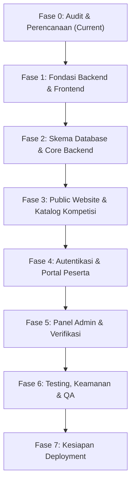

# Development Guide & Implementation Roadmap — IT Competition Management Platform

| Metadata | Value |
|---|---|
| Product | IT Competition Management Platform |
| Guide Version | 1.0.0 |
| Baseline | `PRD.md`, `AGENTS.md`, `ARCHITECTURE.md`, `DATABASE.md`, `API.md` |
| Local Hostnames | Backend: `http://localhost:8000` (atau port yang ditentukan), Frontend: `http://localhost:5173` |
| Database Target | MySQL `127.0.0.1:3306`, DB Name: `it_competition` |

---

## 1. Audit Kesiapan Lingkungan & Dependensi

Berdasarkan audit repositori tahap awal:
- **PHP**: PHP 8.5.10 terpasang (kompatibel penuh dengan requirement `^8.3`).
- **Composer**: 2.10.2 terpasang.
- **Node.js & npm**: Node v24.14.1 dan npm 11.11.0 terpasang.
- **MySQL Server**: MySQL Community Server 8.0.30 (Laragon environment).
- **Backend Framework**: Laravel 13.42.0 sudah terpasang di `backend/`.
- **Frontend SPA**: Direktori `frontend/` masih kosong, siap diinisialisasi menggunakan Vite + React + TypeScript + Tailwind CSS.

---

## 2. Analisis Konfigurasi & Potensi Konflik

1. **Paket Frontend di Direktori Backend (`backend/package.json`)**:
   - Temuan: Di dalam `backend/package.json`, terdapat dependensi bawaan Laravel berupa `@tailwindcss/vite`, `laravel-vite-plugin`, dan `tailwindcss`.
   - Analisis & Dampak: Repositori dirancang menggunakan arsitektur monorepo terpisah di mana antarmuka pengguna berada di `frontend/` (React SPA mandiri). Keberadaan dependensi build di `backend/` berpotensi membingungkan alur pengembangan.
   - Solusi: Seluruh UI React dibangun di dalam direktori `frontend/`. Konfigurasi `backend/package.json` dibiarkan apa adanya (tidak dihapus sembarangan) namun tidak digunakan sebagai tempat komponen UI aplikasi.

2. **CORS & Sanctum SPA Stateful Domains**:
   - Temuan: Saat ini `routes/api.php`, `config/sanctum.php`, dan `config/cors.php` belum diaktifkan/dikonfigurasi penuh di Laravel 13.
   - Analisis & Dampak: Permintaan login dari React (`http://localhost:5173`) ke Laravel (`http://localhost:8000`) akan gagal dengan error *CORS policy* atau *419 CSRF Token Mismatch* jika domain stateful dan cookie session tidak diselaraskan.
   - Solusi: Mengaktifkan rute API melalui `php artisan install:api`, mengonfigurasi `SANCTUM_STATEFUL_DOMAINS=localhost:5173,127.0.0.1:5173`, serta memastikan `supports_credentials: true` di konfigurasi CORS backend dan `withCredentials: true` pada Axios frontend.

3. **Inisialisasi Database MySQL**:
   - Temuan: File `backend/.env` mengarah ke database `it_competition` pada user `root` tanpa password.
   - Solusi: Memastikan database `it_competition` dibuat di MySQL sebelum menjalankan migrasi.

---

## 3. Implementation Roadmap (Peta Jalan Implementasi)

Implementasi dibagi menjadi beberapa fase berurutan sesuai `PRD.md` dan `AGENTS.md`. Setiap fase harus diverifikasi dan disetujui sebelum melangkah ke fase berikutnya.



---

### Fase 0 — Audit Repositori & Perencanaan (Selesai pada tahap ini)
- [x] Membaca dan memahami `PRD.md` dan `AGENTS.md`.
- [x] Memeriksa struktur repositori aktual dan dependensi terpasang.
- [x] Mengidentifikasi potensi konflik konfigurasi.
- [x] Menyusun rancangan arsitektur sistem (`ARCHITECTURE.md`).
- [x] Menyusun spesifikasi skema dan relasi database (`DATABASE.md`).
- [x] Menyusun spesifikasi kontrak API v1 (`API.md`).
- [x] Menyusun panduan implementasi dan roadmap bertahap (`DEVELOPMENT.md`).
- [x] Melaporkan hasil audit untuk mendapatkan persetujuan pengguna sebelum coding.

---

### Fase 1 — Fondasi Backend & Frontend
**Tujuan**: Membangun kerangka komunikasi yang stabil antara React SPA dan Laravel API.

**Pekerjaan Backend**:
1. Menjalankan `php artisan install:api` untuk menginstal Sanctum dan membuat file routing API.
2. Mengonfigurasi routing API agar memiliki prefix resmi `/api/v1` di `bootstrap/app.php`.
3. Mengonfigurasi `config/cors.php` dan `sanctum.php` untuk mengizinkan origin frontend `http://localhost:5173` dengan kredensial aktif (`supports_credentials => true`).
4. Memperbarui `backend/.env` dengan parameter Sanctum:
   - `SANCTUM_STATEFUL_DOMAINS=localhost:5173,127.0.0.1:5173`
   - `SESSION_DOMAIN=localhost`
5. Membuat helper / base controller untuk standar envelope JSON (`success`, `data`, `meta`, `errors`).

**Pekerjaan Frontend**:
1. Menginisialisasi project Vite + React + TypeScript di dalam direktori `frontend/`.
2. Memasang dependensi inti:
   - `tailwindcss` (v4 atau v3 sesuai kompatibilitas Vite React), `@tailwindcss/forms`
   - `react-router-dom` untuk navigasi rute
   - `axios` untuk komunikasi API
   - `react-hook-form` & `zod` (`@hookform/resolvers`) untuk validasi form
   - `lucide-react` untuk ikonografi konsisten
3. Mengonfigurasi Tailwind CSS sesuai token warna resmi:
   - Primary: Orange `#F47B20` (Hover: `#D96512`, Light: `#FFF1E6`)
   - Secondary: Blue `#1769AA` (Hover: `#104C80`, Light: `#EAF4FC`)
   - Neutral backgrounds & texts
4. Menyiapkan instance Axios terpusat (`src/lib/axios.ts`):
   - `baseURL: 'http://localhost:8000'`
   - `withCredentials: true`
   - `withXSRFToken: true`
5. Menyiapkan `AuthProvider` dan rute dasar (PublicLayout, AuthLayout, ParticipantLayout, AdminLayout).
6. Uji konektivitas: Verifikasi bahwa frontend berhasil mengambil CSRF cookie dari backend (`GET /sanctum/csrf-cookie`).

---

### Fase 2 — Skema Database & Core Backend
**Tujuan**: Membangun pondasi data model, migrasi, relasi Eloquent, form request, resource, dan service layer.

**Pekerjaan**:
1. Membuat migrasi database sesuai `DATABASE.md`:
   - `users` (penambahan kolom `role`, `is_active`)
   - `participant_profiles`
   - `events`, `competition_categories`, `competitions`
   - `teams`, `team_members`
   - `registrations`, `registration_documents`
   - `submissions`, `submission_revisions`
   - `schedules`, `announcements`, `faqs`, `notifications`, `activity_logs`, `event_settings`
   - Tabel `payments` (struktur disiapkan namun modul dimatikan secara default)
2. Membuat Enums PHP: `Role`, `RegistrationStatus`, `SubmissionStatus`, `RegistrationType`, `AnnouncementAudience`.
3. Membuat Eloquent Models lengkap dengan `$fillable`, `casts()`, dan relasi (`hasOne`, `hasMany`, `belongsTo`, `belongsToMany`).
4. Membuat Database Seeders:
   - `AdminUserSeeder`: Membuat akun admin lokal awal dengan kredensial aman.
   - `CompetitionCategorySeeder`: Menyiapkan kategori lomba dasar.
   - `DemoEventSeeder`: Menyiapkan data acara demo dan cabang lomba untuk pengujian.
5. Membuat Policies:
   - `RegistrationPolicy`: Memastikan peserta hanya bisa mengakses registrasi miliknya.
   - `TeamPolicy`: Memastikan hanya ketua tim yang bisa mengedit atau mengundang anggota.
   - `SubmissionPolicy`: Memastikan submisi terikat pada registrasi yang valid dan disetujui.
6. Membuat Form Requests & API Resources untuk seluruh entitas.
7. Membuat Service Layer (`RegistrationService`, `SubmissionService`, `ActivityLogService`).
8. Membuat pengujian otomatis backend (*Pest / PHPUnit*) untuk memverifikasi integritas database dan otorisasi.

---

### Fase 3 — Website Publik & Katalog Kompetisi
**Tujuan**: Menyediakan antarmuka publik yang informatif, menarik, responsif, dan terhubung ke API data riil.

**Pekerjaan**:
1. Mengembangkan komponen UI atomik: `Button`, `Card`, `Badge`, `Input`, `Select`, `Modal`, `Accordion`, `Tabs`, `Skeleton`.
2. Mengembangkan layout publik (`PublicNavbar`, `PublicFooter`) dengan navigasi responsif (menu mobile drawer).
3. Halaman Beranda (`/`):
   - Hero section modern dengan identitas acara dan tombol CTA ke pendaftaran/katalog.
   - Seksi tentang acara dan tema kompetisi.
   - Grid kategori kompetisi (diambil dari `GET /api/v1/categories` & `/competitions`).
   - Timeline jadwal tahapan acara (diambil dari `GET /api/v1/schedules`).
   - Metrik statistik database publik (diambil dari `GET /api/v1/public/statistics`).
   - Pengumuman terbaru & FAQ accordion.
4. Halaman Katalog Kompetisi (`/competitions`):
   - Pencarian berdasarkan nama kompetisi.
   - Filter berdasarkan kategori dan status registrasi.
   - Paginasi data yang responsif.
   - Kartu kompetisi menampilkan cover, tipe (individu/tim), batas anggota, deadline, dan biaya.
5. Halaman Detail Kompetisi (`/competitions/:slug`):
   - Deskripsi lengkap, kriteria kelayakan peserta, peraturan teknis.
   - Tombol unduh guidebook PDF.
   - Tombol "Daftar Sekarang" yang mengarahkan ke alur pendaftaran (atau ke login dengan redirect aman jika belum masuk).
6. Halaman Jadwal (`/schedule`), Pengumuman (`/announcements`, `/announcements/:slug`), dan FAQ (`/faq`).
7. Halaman Kebijakan Privasi (`/privacy`) dan Syarat Ketentuan (`/terms`).

---

### Fase 4 — Autentikasi & Portal Peserta
**Tujuan**: Memungkinkan peserta mendaftar akun, mengelola profil, membentuk tim, mendaftar kompetisi, mengunggah dokumen, dan mengirim karya.

**Pekerjaan**:
1. Alur Autentikasi:
   - Halaman Registrasi (`/register`): Validasi nama, email unik, password kuat, konfirmasi password, dan persetujuan syarat ketentuan. Otomatis menetapkan role `participant`.
   - Halaman Login (`/login`): Rate limited, pesan error generik, integrasi dengan Sanctum SPA session.
   - Halaman Lupa Password (`/forgot-password`).
2. Portal Peserta (`/participant/dashboard`):
   - Ringkasan pendaftaran aktif, status verifikasi, dan tenggat waktu mendatang.
3. Manajemen Profil (`/participant/profile`):
   - Form pengisian institusi/sekolah, jenjang pendidikan, nomor telepon/WhatsApp, dan unggah avatar.
4. Manajemen Tim (`/participant/teams`):
   - Pembuatan tim baru oleh peserta (ketua).
   - Penambahan anggota tim berdasarkan email terdaftar.
   - Pembatasan mutasi tim jika tim telah memiliki pendaftaran kompetisi aktif yang disubmit.
5. Alur Pendaftaran Kompetisi Multi-Tahap (`/participant/registrations/create`):
   - Tahap 1: Pemilihan cabang kompetisi.
   - Tahap 2: Konfirmasi mode pendaftaran (individu atau pilih tim terdaftar).
   - Tahap 3: Verifikasi kelengkapan profil seluruh anggota.
   - Tahap 4: Unggah dokumen persyaratan (KTM, surat pernyataan).
   - Tahap 5: Ringkasan & Submit Final.
   - Draf pendaftaran dapat disimpan dan dilanjutkan kapan saja.
6. Pengumpulan Karya Lomba (`/participant/submissions`):
   - Hanya terbuka untuk pendaftaran yang berstatus `approved`.
   - Validasi tenggat waktu (*deadline check*) di server.
   - Unggah berkas ZIP/PDF atau URL repositori / demo link.
   - Riwayat revisi submisi jika panitia meminta perbaikan.
7. Notifikasi Peserta:
   - Pemberitahuan in-app ketika status registrasi berubah atau berkas perlu direvisi.

---

### Fase 5 — Panel Admin & Alur Verifikasi
**Tujuan**: Menyediakan dashboard operasional panitia untuk mengelola data, memverifikasi pendaftaran, meninjau berkas, dan mempublikasikan konten.

**Pekerjaan**:
1. Dashboard Admin (`/admin/dashboard`):
   - Metrik statistik database real-time: total pendaftar, registrasi menunggu verifikasi, submisi karya masuk.
   - Grafik tren pendaftaran dan distribusi kategori.
2. Manajemen Acara & Kompetisi (`/admin/events`, `/admin/competitions`, `/admin/categories`):
   - Formulir CRUD lengkap: cover, kuota, tanggal buka/tutup, batas submit, guidebook.
3. Verifikasi Pendaftaran & Dokumen (`/admin/registrations`):
   - Pencarian berdasarkan nomor registrasi (`ITC-YYYY-XXXXX`), nama tim, atau peserta.
   - Filter status (`submitted`, `under_review`, `approved`, `rejected`, `revision_required`).
   - Tampilan detail berkas dokumen persyaratan peserta melalui viewer aman.
   - Aksi: Setujui (*Approve*), Tolak (*Reject* disertai alasan), atau Minta Perbaikan (*Revision Required* disertai catatan detail).
   - Setiap keputusan mencatat actor admin, status lama, status baru, catatan, dan timestamp ke `activity_logs`.
4. Peninjauan Submisi Karya (`/admin/submissions`):
   - Memeriksa kelengkapan file karya, link repositori, dan kesesuaian waktu submit.
   - Memperbarui status peninjauan administratif.
5. CMS Panitia:
   - Manajemen Jadwal (`/admin/schedules`).
   - Manajemen Pengumuman (`/admin/announcements`) dengan opsi audience (`public`, `all_participants`, `specific_competition`).
   - Manajemen FAQ (`/admin/faqs`).
   - Pengaturan Website & Kontak (`/admin/settings`).
6. Laporan & Ekspor Data (`/admin/reports`):
   - Filter data pendaftar dan submisi berdasarkan kompetisi.
   - Ekspor data dalam format file CSV.
7. Audit Log (`/admin/activity-logs`):
   - Menampilkan catatan aktivitas administratif secara transparan dan tidak dapat dimanipulasi (*append-only*).

---

### Fase 6 — Testing, Pengerasan Keamanan & QA
**Tujuan**: Menguji seluruh alur kerja kritis, menegakkan batasan otorisasi, dan memastikan kestabilan aplikasi.

**Pekerjaan**:
1. Automated Backend Tests:
   - Validasi kepemilikan resource (Peserta A tidak boleh mengakses data Peserta B).
   - Mencegah peserta melakukan penetapan role admin secara sepihak.
   - Pengujian mesin status pendaftaran (mencegah lompatan status ilegal).
   - Pengujian batas ukuran dan tipe MIME berkas unggahan.
2. Keamanan Penyimpanan Dokumen:
   - Memastikan berkas privat peserta tidak dapat diakses secara publik melalui URL statis langsung.
   - Memverifikasi endpoint unduhan berotorisasi (`GET /api/v1/documents/*`).
3. Pengujian Tampilan & Aksesibilitas:
   - Memeriksa tampilan antarmuka pada resolusi ponsel pintar (360px - 414px), tablet (768px), dan desktop (1280px+).
   - Memeriksa status komponen interaktif (fokus keyboard, kontras warna, label formulir, loading spinner).

---

### Fase 7 — Kesiapan Deployment
**Tujuan**: Mempersiapkan build produksi, konfigurasi server, dan dokumentasi operasional.

**Pekerjaan**:
1. Konfigurasi Environment Produksi (`.env.production`):
   - `APP_ENV=production`, `APP_DEBUG=false`.
   - Setup HTTPS, secure cookies (`SESSION_SECURE_COOKIE=true`).
2. Build Asset Frontend:
   - `npm run build` menghasilkan bundle statis yang teroptimasi di `frontend/dist`.
3. Optimasi Cache Backend:
   - `php artisan config:cache`, `php artisan route:cache`, `php artisan view:cache`.
4. Penyusunan SOP pencadangan database (*database backup*) dan checklist pemeliharaan server.

---

## 4. Panduan Menjalankan Perintah Verifikasi

### Backend:
```bash
# Menjalankan test suite backend
php artisan test

# Memeriksa daftar rute API terdaftar
php artisan route:list --path=api

# Memeriksa status migrasi database
php artisan migrate:status
```

### Frontend (dari dalam `frontend/`):
```bash
# Memeriksa pengecekan tipe data TypeScript
npm run build -- --noEmit

# Menjalankan build bundle produksi
npm run build

# Menjalankan linter
npm run lint
```

---

## 5. Format Laporan Selesai Fase (Phase Completion Template)

Setiap agen wajib menggunakan format berikut di akhir pengerjaan suatu fase:

```text
Fase: [Nomor dan Nama Fase]
Ringkasan: [Uraian singkat pekerjaan yang diselesaikan]
File yang dibuat: [Daftar file baru]
File yang diubah: [Daftar file yang dimodifikasi]
Perubahan Database: [Migrasi / Seeder yang dieksekusi]
Perubahan API: [Daftar endpoint baru / diperbarui]
Perintah yang dijalankan: [Perintah artisan, npm, composer]
Hasil Pengujian: [Hasil eksekusi test suite]
Isu / Keterbatasan: [Catatan teknis jika ada]
Keputusan Terbuka: [Pertanyaan yang butuh konfirmasi]
Rekomendasi Fase Berikutnya: [Langkah selanjutnya]
```
